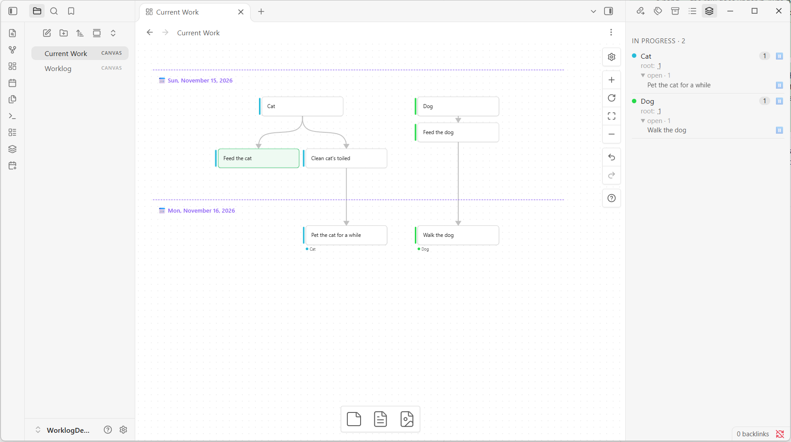

# Worklog Timeline

Turn an Obsidian canvas into a worklog. Each card is a task, arrows are "what came next",
and the plugin keeps track of where you are.

[Русская версия](README.ru.md)



- The top card is a project. All of its descendants get its color.
- Any card can be marked done or cancelled: green color, ✅ or ❌.
- Every card has a creation date.
- Leaves are your current work. There can be any number of them, but 5 is the comfortable
  limit of parallel tasks for most people.
- When you add a new card or drag a current one, all active ones line up in one row.
- Date bands split time into days.
- Pause a whole project or just specific tasks.
- A project whose last task is done and has nothing after it goes on the shelf
  (*Dormant*): pick it up again whenever you need.

## Details

- **Date bands.** A dashed dated line across the whole canvas. By default it appears by itself:
  the first card after a 6-hour break gets a band above it, so a night session past midnight
  stays one day; a canvas without bands gets one on its first new card. New cards line up
  below a band if you drop them below it, and stay above it if you drop them above. The setting can switch to "each calendar day" (the day starts at 4:00) or off.
  The command puts a band for any date, past or future, at the center of the screen; one band
  per date. The label is plain text: rename it to a stage if you like.
- **Creation dates.** Every new card gets a small timestamp, shown on hover or always.
- **Projects.** A card belongs to the nearest root above it (a card with no incoming arrows).
  Each project gets a color stripe, and open and finished branches get a project tag.
  `Project / Subsection` in a root's first line splits one project into several roots.
- **Open-branch counter.** The status bar shows how many leaf cards are still open
  against your comfort limit. Click it to highlight them.
- **Card menu.** Right-click a card or a selection: *Done ✅*, *Cancelled ❌*,
  *Pause task*, *Pause project ⏸* and *Lay out under parent*. A pause is a `⏸` at the start
  of the card's text: on a root it pauses the whole project, on any other card it pauses that
  task and everything below it. It is visible in the canvas, undoable with Ctrl+Z, and you can
  type it by hand.
- **Auto-layout.** When you drag a new card out of a parent, it is centered under it
  and all open branches line up in one row. Creation and layout undo in a single step.
  Only open branches move: done cards, roots, paused cards and other projects stay where they
  are. If the spot under the parent is taken, or the arrow would run through someone else's
  card, the new card goes to the nearest free spot beside it. Arrows drawn between existing
  cards, pasted cards and cards that arrive by sync are left alone.
- **Projects panel.** A side panel lists projects (in progress, paused, dormant), freshest first,
  with a smooth jump to each project's work front (its newest open branch) or any of its roots.
  Each project has collapsible lists of its open and paused tasks, with pause and resume buttons.
- **Checklists.** A card with checkboxes turns green once every `- [ ]` is ticked, and gets its
  old color back when you untick one. A card you recolor by hand keeps that color until you
  tick or untick something again.
- **Archive.** For one-off projects: the 🗄 button in the panel or *Archive project* in the card
  menu. An archived project stays in the list while it has open tasks and hides once they are
  done; the collapsed *Archive* section at the bottom shows it on request.

A card counts as done when it is green (color 4), starts with ❌, or its first line starts
with ✅ / ☑ / `~~` / `- [x]` and it has no unchecked `- [ ]`.

## Installation

Not in the community store yet. Manual install:

1. Download `main.js`, `manifest.json` and `styles.css` from the latest release.
2. Put them in `<vault>/.obsidian/plugins/worklog-timeline/`.
3. Enable **Worklog Timeline** in *Settings → Community plugins*.

## Tests

The layout and checklist logic is covered by tests with no dependencies (Node 18+):

```
node --test tests/
```

## Languages

English and Russian. The plugin follows Obsidian's interface language.
To add a language, add a table to `STRINGS` at the top of `main.js` with the same keys.

## Notes

The plugin relies on undocumented parts of the Canvas API. Every call is guarded,
but a future Obsidian update may break some features.

## License

MIT
