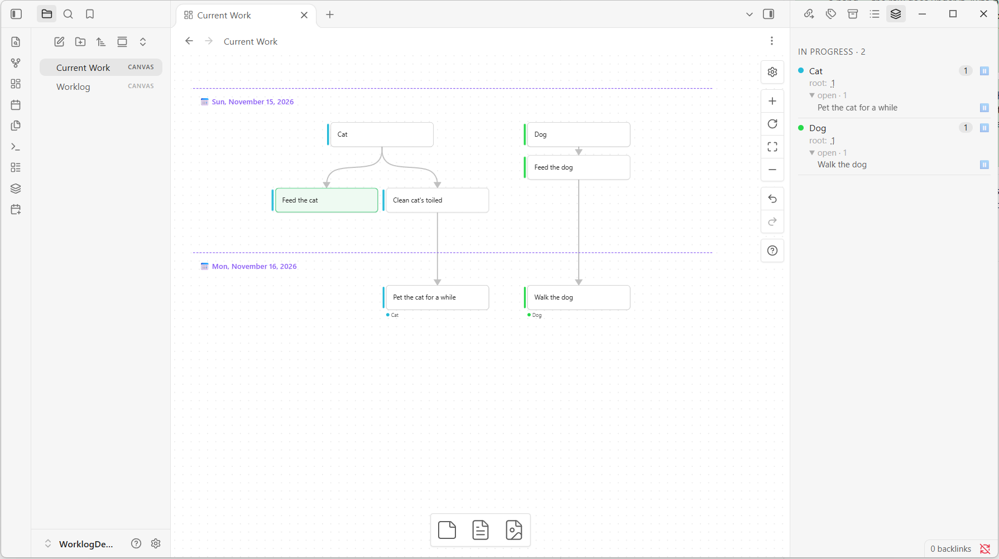

# Worklog Timeline

Превращает канвас Obsidian в рабочий журнал. Карточка — задача, стрелка — «что дальше»,
а плагин следит, где ты сейчас.

[English version](README.md)



- Первая карточка — проект. У всех её потомков — его цвет.
- Любую карточку можно пометить «готово» или «отменено»: зелёным цветом, ✅ или ❌.
- У всех карточек есть дата создания.
- Все листья — это текущие работы. Их может быть сколько угодно, но 5 — предел комфортной
  работы над несколькими задачами параллельно для большинства людей.
- При добавлении новой карточки или переносе текущей все активные выравниваются в одну строку.
- Линии дат делят время на дни.
- Пауза: можно поставить весь проект целиком, а можно только конкретные задачи.
- Проект, в котором последняя задача выполнена и не имеет потомков, попадает на полку
  («Спят»): потом можно продолжить, если понадобится.

## Подробнее

- **Рубежи дат.** Пунктирная линия с датой через весь канвас. По умолчанию ставится сама:
  первая карточка после 6 часов перерыва получает рубеж над собой, так что ночная сессия
  через полночь остаётся одним днём; канвас без рубежей получает его на первой новой карточке.
  Отпустил новую карточку под рубежом — строка открытых задач встанет под ним, над — останется
  над ним. В настройках — «каждый календарный день» (день
  начинается в 4:00) или выключить. Команда ставит рубеж на любую дату, хоть задним числом,
  хоть на будущее, в центр экрана; на одну дату — один рубеж. Подпись — обычный текст:
  можно переименовать в этап.
- **Даты создания.** У каждой новой карточки — метка времени, при наведении или всегда.
- **Проекты.** Карточка относится к ближайшему корню над ней (карточке без входящих стрелок).
  У проекта своя цветная полоска, у открытых и закрытых веток — ярлычок проекта.
  `Проект / Подраздел` в первой строке корня делит один проект на несколько корней.
- **Счётчик открытых веток.** В строке состояния — сколько листовых карточек ещё открыто
  против твоего комфортного предела. Клик — подсветить их.
- **Меню карточки.** Правый клик по карточке или выделению: *Закрыть ✅*, *Отменено ❌*,
  *Отложить задачу*, *Отложить проект ⏸* и *Разложить под родителем*. Пауза — это `⏸`
  в начале текста карточки: на корне откладывает весь проект, на любой другой карточке — эту
  задачу и всё, что под ней. Видна на канвасе, откатывается Ctrl+Z, её можно поставить руками.
- **Авторасклад.** Вытянул новую карточку из родителя — она встаёт по центру под ним,
  а все открытые ветки выравниваются в строку. Создание и расклад отменяются одним шагом.
  Двигаются только открытые ветки: закрытые карточки, корни, отложенное и чужие проекты стоят
  на месте. Если место под родителем занято или стрелка прошла бы через чужую карточку, новая
  карточка встаёт на ближайшее свободное место рядом. Стрелки между старыми карточками,
  вставка из буфера и карточки, пришедшие синхронизацией, расклад не трогает.
- **Панель проектов.** Боковая панель со списком проектов (в работе, отложены, спят), свежие сверху,
  и плавным перелётом к фронту работы проекта (самой новой открытой ветке) или к любому из корней.
  У каждого проекта — раскрывающиеся списки задач в работе и отложенных, с кнопками паузы и возврата.
- **Чек-листы.** Карточка с чекбоксами зеленеет, когда отмечены все `- [ ]`, и возвращает
  прежний цвет, если снять хотя бы одну галочку. Цвет, поставленный руками, остаётся, пока
  не отметишь или не снимешь галочку.
- **Архив.** Для разовых проектов: кнопка 🗄 в панели или «В архив» в меню карточки.
  Пока у проекта есть открытые задачи, он в списке как обычно; когда всё закрыто — прячется.
  Свёрнутый раздел «Архив» внизу панели показывает его по запросу.

Карточка закрыта, если она зелёная (цвет 4), начинается с ❌ или её первая строка
начинается с ✅ / ☑ / `~~` / `- [x]` и в ней нет незакрытых `- [ ]`.

## Установка

Пока не в каталоге плагинов. Вручную:

1. Скачай `main.js`, `manifest.json` и `styles.css` из последнего релиза.
2. Положи их в `<хранилище>/.obsidian/plugins/worklog-timeline/`.
3. Включи **Worklog Timeline** в *Настройки → Сторонние плагины*.

## Тесты

Логика раскладки и чек-листов покрыта тестами без зависимостей (Node 18+):

```
node --test tests/
```

## Языки

Английский и русский — по языку интерфейса Obsidian.

## Лицензия

MIT
